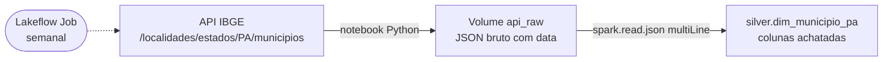

# C1: Cadastro de municípios do IBGE para o time comercial

**Situação:** não iniciado.
**Seções do guia:** 2 (REST em notebook orquestrado por Jobs; JSON aninhado para Delta), 3 (reestruturar colunas) e 4 (Job agendado).
**Caderno de Estudos:** A4, A5 e A7.

## A história

O time comercial vai dividir o Pará em territórios de venda. Eles pediram uma tabela com todos os municípios do estado, a mesorregião e a região imediata de cada um, atualizada toda semana. Hoje alguém baixa uma planilha à mão. Seu trabalho: automatizar.

## O que você vai treinar

- Chamar uma API REST de dentro de um notebook e guardar a resposta bruta (a bronze é o arquivo).
- Ler JSON com estrutura aninhada e achatar os campos para colunas.
- Gravar a silver de forma idempotente (rodar 2 vezes dá o mesmo resultado).
- Agendar o notebook num Lakeflow Job.

## Arquitetura



## Fonte (conferida)

- API Localidades v1 do IBGE, rota aninhada `/estados/{UF}/municipios`. Base `https://servicodados.ibge.gov.br/api/v1/localidades`. Padrão de resposta: hierárquico (`view=nivelado` deixa plano). Fonte: servicodados.ibge.gov.br/api/docs/localidades (skill ibge-apis-docs, conferida em 24/10/2026).
- Chamada real em 24/10/2026: `/municipios/1504208` (Marabá) retornou microrregião, mesorregião, região imediata, região intermediária, UF e região.
- Limites de taxa e termos de uso: **não publicados** nas páginas lidas. Faça poucas chamadas.

---

## Parte 0: teste de internet de saída

### Passo 0.1. Criar o notebook e o volume

- **Ação:** New, Notebook, nome `c1_ibge_municipios`, linguagem **Python**, Serverless. Na célula 1, colar e executar.
- **Por quê:** a resposta bruta da API precisa de um lugar governado; volume é o recomendado para arquivo.
- **O que acontece:** cria o volume gerenciado `api_raw` no schema bronze.
- **Conferência:** a célula termina sem erro e o volume aparece em Catalog, `lab_de`, `bronze`.

```python
# Cria o volume que guarda as respostas brutas das APIs (se ainda não existir)
spark.sql("CREATE VOLUME IF NOT EXISTS lab_de.bronze.api_raw")
```

### Passo 0.2. Testar a chamada

- **Ação:** nova célula, colar e executar.
- **Por quê:** a Free Edition restringe internet de saída; antes de escrever o pipeline, provar se o notebook alcança a API.
- **O que acontece:** faz um GET simples e mostra o status HTTP e o começo da resposta.
- **Conferência:** status `200` e um texto começando com `{"id":1504208`. Se der erro de rede (DNS, timeout, conexão recusada), siga o **plano B** no fim deste arquivo.

```python
# Biblioteca padrão do Python para HTTP (não precisa instalar nada)
import urllib.request
# URL de um município só (Marabá), resposta pequena para o teste
url = "https://servicodados.ibge.gov.br/api/v1/localidades/municipios/1504208"
# Abre a conexão com limite de 30 segundos
with urllib.request.urlopen(url, timeout=30) as resp:
    # Mostra o status HTTP (esperado 200)
    print(resp.status)
    # Mostra os primeiros 200 caracteres da resposta
    print(resp.read().decode("utf-8")[:200])
```

**Entrega da parte 0:** cole o status e o trecho impresso (ou a mensagem de erro).

---

## Parte 1: buscar e guardar a resposta bruta

### Passo 1.1. Baixar os municípios do Pará para o volume

- **Ação:** nova célula, colar e executar.
- **Por quê:** a bronze guarda o dado exatamente como veio, com data no nome, para auditoria e reprocesso.
- **O que acontece:** chama a rota do estado, grava o JSON num arquivo novo por execução.
- **Conferência:** imprime o caminho do arquivo e o número de bytes (maior que zero).

```python
# Bibliotecas padrão: HTTP, data/hora e sistema de arquivos
import urllib.request, datetime, os
# Rota oficial: municípios de uma UF (PA), formato hierárquico padrão
url = "https://servicodados.ibge.gov.br/api/v1/localidades/estados/PA/municipios"
# Carimbo de data e hora da extração, usado no nome do arquivo
ts = datetime.datetime.now().strftime("%Y%m%d_%H%M%S")
# Pasta da fonte dentro do volume (uma pasta por API)
pasta = "/Volumes/lab_de/bronze/api_raw/ibge_municipios"
# Cria a pasta se ainda não existir (volume aceita os comandos do módulo os)
os.makedirs(pasta, exist_ok=True)
# Caminho do arquivo desta execução
destino = f"{pasta}/municipios_pa_{ts}.json"
# Faz a chamada à API com limite de 60 segundos
with urllib.request.urlopen(url, timeout=60) as resp:
    # Lê a resposta inteira como texto
    corpo = resp.read().decode("utf-8")
# Grava o texto como veio, sem transformar
with open(destino, "w", encoding="utf-8") as f:
    # Escreve o conteúdo no arquivo do volume
    f.write(corpo)
# Mostra onde gravou e o tamanho, para conferência
print(destino, len(corpo))
```

### Passo 1.2. Ver o formato real

- **Ação:** nova célula, colar e executar.
- **Por quê:** o código da parte 2 depende dos nomes reais dos campos aninhados.
- **O que acontece:** lê o arquivo como JSON de várias linhas (a resposta é um array) e mostra o schema.
- **Conferência:** aparece uma árvore com `id`, `nome`, `microrregiao` (com `mesorregiao` e `UF` dentro) e um campo de região imediata. Anote o nome exato dele (o IBGE usa hífen em alguns nomes).

```python
# Lê todos os arquivos da pasta; multiLine porque a resposta é um único array JSON
df_raw = spark.read.option("multiLine", "true").json("/Volumes/lab_de/bronze/api_raw/ibge_municipios/")
# Mostra a árvore de campos e tipos inferidos
df_raw.printSchema()
# Mostra quantos municípios vieram (linhas)
print(df_raw.count())
```

**Entrega da parte 1:** cole o `printSchema` e a contagem.

---

## Parte 2: achatar e gravar a silver (conferir nomes com a parte 1)

### Passo 2.1. Criar `lab_de.silver.dim_municipio_pa`

- **Ação:** nova célula, colar, **ajustar os nomes dos campos ao schema da parte 1**, executar.
- **Por quê:** BI e time comercial precisam de colunas simples, não de struct.
- **O que acontece:** acessa campos aninhados com ponto, renomeia, pega só o arquivo mais recente e sobrescreve a silver.
- **Conferência:** a contagem da silver é igual à da parte 1 (sem duplicar, porque só o arquivo mais recente entra).

```python
# Funções do Spark para colunas e para o caminho do arquivo de origem
from pyspark.sql import functions as F
# Lê de novo a pasta e guarda de qual arquivo veio cada linha
df = (spark.read.option("multiLine", "true").json("/Volumes/lab_de/bronze/api_raw/ibge_municipios/")
      # _metadata.file_path é a coluna oficial com o caminho do arquivo
      .withColumn("arquivo_origem", F.col("_metadata.file_path")))
# Descobre o arquivo mais recente (o nome tem a data, então o maior é o último)
ultimo = df.agg(F.max("arquivo_origem")).first()[0]
# Achata os campos aninhados em colunas simples (ajuste os nomes conforme a parte 1)
silver = (df.where(F.col("arquivo_origem") == ultimo)
          # Seleciona e renomeia cada campo
          .select(
              # Código IBGE do município
              F.col("id").alias("cod_municipio"),
              # Nome do município
              F.col("nome").alias("municipio"),
              # Mesorregião (dentro de microrregiao)
              F.col("microrregiao.mesorregiao.nome").alias("mesorregiao"),
              # Microrregião
              F.col("microrregiao.nome").alias("microrregiao"),
              # Região imediata: nome com hífen exige crase (conferir na parte 1)
              F.col("`regiao-imediata`.nome").alias("regiao_imediata"),
              # Sigla da UF
              F.col("microrregiao.mesorregiao.UF.sigla").alias("uf"),
              # Auditoria: de onde veio a linha
              F.col("arquivo_origem"),
              # Auditoria: quando foi carregada
              F.current_timestamp().alias("carregado_em")))
# Sobrescreve a silver inteira: rodar de novo não duplica (idempotente)
silver.write.mode("overwrite").option("overwriteSchema", "true").saveAsTable("lab_de.silver.dim_municipio_pa")
# Conferência: total gravado
print(spark.table("lab_de.silver.dim_municipio_pa").count())
```

### Passo 2.2. Checar qualidade

- **Ação:** nova célula `%sql`, colar e executar.
- **Por quê:** dimensão sem chave única quebra o join do BI.
- **O que acontece:** compara total com chaves distintas e conta nulos.
- **Conferência:** `total = distintos` e `sem_regiao = 0`. Marabá (1504208) aparece no filtro.

```sql
-- Total de linhas e de chaves distintas devem ser iguais
SELECT COUNT(*) AS total, COUNT(DISTINCT cod_municipio) AS distintos,
       -- Municípios sem mesorregião indicam campo errado no achatamento
       count_if(mesorregiao IS NULL) AS sem_regiao
-- Tabela silver criada no passo anterior
FROM lab_de.silver.dim_municipio_pa;
-- Confere um município conhecido
SELECT * FROM lab_de.silver.dim_municipio_pa WHERE cod_municipio = 1504208;
```

---

## Parte 3: agendar no Lakeflow Jobs

1. **Ação:** separar o notebook em dois: `c1_extrair` (passo 1.1) e `c1_silver` (passo 2.1).
   - **Por quê:** cada notebook vira uma tarefa, e o retry de uma não refaz a outra.
   - **Conferência:** os dois notebooks rodam sozinhos sem erro.
2. **Ação:** Jobs & Pipelines, Create, Job, tarefa `extrair` (notebook `c1_extrair`), tarefa `silver` dependendo de `extrair`.
   - **Por quê:** é o padrão "REST em notebook orquestrado por Jobs" do guia.
   - **Conferência:** o DAG mostra `extrair` e depois `silver`.
3. **Ação:** em Schedules & Triggers, adicionar Scheduled semanal. Em `extrair`, Retries: 2.
   - **Por quê:** API externa falha às vezes; retry na tarefa que chama a API.
   - **Conferência:** o job mostra o próximo horário agendado.
4. **Ação:** Run now, conferir o run, depois **pausar** o schedule.
   - **Por quê:** não gastar a cota da conta.
   - **Conferência:** run `Succeeded`, nova linha de arquivo na pasta `ibge_municipios`.

---

## Parte 4: perguntas de prova

1. Um notebook chama uma API REST toda semana e grava em Delta. Qual é a forma recomendada de agendar e dar retry? (a) loop `while True` com `time.sleep` no notebook (b) Lakeflow Job com schedule e retries na tarefa (c) `%run` dentro de outro notebook (d) Trigger.ProcessingTime no streaming
2. Verdadeiro ou falso: para ler um arquivo cujo conteúdo é um único array JSON, é preciso `multiLine` = true.
3. O campo `regiao-imediata` tem hífen. Como acessá-lo no PySpark? (a) `F.col("regiao-imediata.nome")` (b) `` F.col("`regiao-imediata`.nome") `` (c) `F.col(regiao_imediata.nome)` (d) não é possível

Responda antes de ver a correção no chat.

## Plano B (sem internet de saída no workspace)

No **Windows Terminal**, na sua máquina:

```powershell
# Chama a mesma rota do IBGE a partir do seu computador
$r = Invoke-WebRequest -Uri "https://servicodados.ibge.gov.br/api/v1/localidades/estados/PA/municipios"
# Monta o nome do arquivo com data e hora
$arq = "municipios_pa_$(Get-Date -Format yyyyMMdd_HHmmss).json"
# Grava a resposta como veio, em UTF-8 sem BOM (o BOM do Out-File pode quebrar a leitura do JSON)
[System.IO.File]::WriteAllText("$PWD\$arq", $r.Content)
# Sobe para o volume (a CLI exige o prefixo dbfs:/ nos caminhos de volume)
databricks fs cp $arq "dbfs:/Volumes/lab_de/bronze/api_raw/ibge_municipios/$arq"
```

Depois siga da Parte 1, passo 1.2. A Parte 3 fica com só a tarefa `silver`, e a extração vira um passo manual (registre isso como limitação do ambiente).
