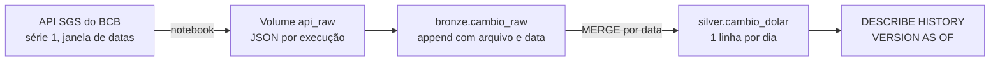

# C2: Câmbio diário com correção retroativa (API do Banco Central)

**Situação:** não iniciado.
**Seções do guia:** 2 (carga incremental), 3 (dedup, MERGE) e 1 (Delta: time travel e auditoria).
**Caderno de Estudos:** A4, A5 e A1.
**Questão do guia ligada:** 2 (rollback, auditoria e fonte única: Delta com Unity Catalog).

## A história

O financeiro fecha contratos em dólar e usa a cotação de venda do dia. A carga diária pega só os dias novos. Um dia o auditor pergunta: "o valor de tal data mudou depois que vocês carregaram?". Fornecedores de dado às vezes **revisam** valores já publicados. Você precisa de uma carga que atualize o que mudou, insira o que é novo, não duplique nada e deixe rastro para auditoria.

## O que você vai treinar

- Carga incremental com **janela de reprocessamento** (pega de novo os últimos dias para capturar revisões).
- `MERGE INTO` com `WHEN MATCHED AND valor mudou THEN UPDATE` e `WHEN NOT MATCHED THEN INSERT`.
- `DESCRIBE HISTORY` e `VERSION AS OF` para responder ao auditor.

## Arquitetura



## Fonte (conferida em 19/11/2026)

Página oficial do serviço: dadosabertos.bcb.gov.br, recurso "json_serie-sgs" do SGS.

- Endereço: `https://api.bcb.gov.br/dados/serie/bcdata.sgs.{codigo_serie}/dados?formato=json&dataInicial={dataInicial}&dataFinal={dataFinal}`.
- `dataInicial` e `dataFinal` no formato `dd/MM/aaaa`. A diferença entre elas não pode passar de 10 anos.
- Desde 26/03/2025 o volume retornado é limitado e **o uso de filtros é obrigatório**.
- Últimos N valores: `.../dados/ultimos/{N}?formato=json`, com N até 20.
- Série 1: "Taxa de câmbio, livre, dólar americano (venda), diário" (código no nome do conjunto de dados no portal).
- **O formato da resposta (nomes dos campos) não é publicado na página.** A parte 1 mostra o JSON real antes de qualquer código que dependa dele.

---

## Parte 0: internet de saída

Mesmo teste do C1 (passo 0.2), trocando a URL por:
`https://api.bcb.gov.br/dados/serie/bcdata.sgs.1/dados/ultimos/5?formato=json`

**Conferência:** status `200` e um array JSON pequeno. Sem rede, use o plano B no fim.

---

## Parte 1: buscar uma janela e ver o formato real

### Passo 1.1. Baixar os últimos 30 dias

- **Ação:** notebook `c2_cambio` (Python, Serverless), célula 1.
- **Por quê:** o filtro de datas é obrigatório; uma janela curta também é o que a carga diária vai usar.
- **O que acontece:** monta a URL com datas no formato exigido, grava a resposta bruta no volume.
- **Conferência:** imprime o caminho e o tamanho; o arquivo aparece em `api_raw/bcb_cambio`.

```python
# Bibliotecas padrão: HTTP, datas e sistema de arquivos
import urllib.request, datetime, os
# Código da série SGS (1 = dólar venda diário)
serie = 1
# Data final da janela: hoje
fim = datetime.date.today()
# Data inicial: 30 dias atrás (janela que também recaptura revisões)
inicio = fim - datetime.timedelta(days=30)
# Monta a URL com as datas no formato dd/MM/aaaa exigido pela API
url = (f"https://api.bcb.gov.br/dados/serie/bcdata.sgs.{serie}/dados?formato=json"
       # Parâmetro de data inicial
       f"&dataInicial={inicio:%d/%m/%Y}"
       # Parâmetro de data final
       f"&dataFinal={fim:%d/%m/%Y}")
# Pasta da fonte dentro do volume
pasta = "/Volumes/lab_de/bronze/api_raw/bcb_cambio"
# Cria a pasta se não existir
os.makedirs(pasta, exist_ok=True)
# Nome do arquivo com a data e hora da extração
destino = f"{pasta}/serie{serie}_{datetime.datetime.now():%Y%m%d_%H%M%S}.json"
# Chama a API com limite de 60 segundos
with urllib.request.urlopen(url, timeout=60) as resp:
    # Lê a resposta como texto
    corpo = resp.read().decode("utf-8")
# Grava a resposta bruta sem transformar
with open(destino, "w", encoding="utf-8") as f:
    # Escreve no volume
    f.write(corpo)
# Mostra o caminho, o tamanho e o começo do conteúdo
print(destino, len(corpo), corpo[:200])
```

### Passo 1.2. Ver o schema

```python
# Lê o arquivo gravado; multiLine porque a resposta é um array JSON
df = spark.read.option("multiLine", "true").json("/Volumes/lab_de/bronze/api_raw/bcb_cambio/")
# Mostra os nomes e tipos reais dos campos
df.printSchema()
# Mostra as primeiras linhas como vieram
df.show(5, truncate=False)
```

- **Conferência:** anote o nome do campo de data, o do valor, o **tipo** de cada um (string ou número) e o formato da data (ex.: `dd/MM/aaaa`).

**Entrega da parte 1:** cole o `printSchema` e as 5 linhas.

---

## Parte 2: bronze append e silver com MERGE (conferir nomes com a parte 1)

O código abaixo supõe os campos `data` (texto `dd/MM/aaaa`) e `valor` (texto com ponto decimal). **Troque pelos nomes e formatos reais** que a parte 1 mostrar.

### Passo 2.1. Bronze: guardar tudo com rastro

```python
# Funções de coluna do Spark
from pyspark.sql import functions as F
# Lê todos os arquivos já baixados
df = (spark.read.option("multiLine", "true").json("/Volumes/lab_de/bronze/api_raw/bcb_cambio/")
      # Guarda o arquivo de origem de cada linha
      .withColumn("arquivo_origem", F.col("_metadata.file_path"))
      # Guarda quando o arquivo foi modificado (proxy da hora da extração)
      .withColumn("extraido_em", F.col("_metadata.file_modification_time")))
# Sobrescreve a bronze com todo o histórico de arquivos (reprocessável a qualquer momento)
df.write.mode("overwrite").option("overwriteSchema", "true").saveAsTable("lab_de.bronze.cambio_raw")
```

### Passo 2.2. Criar a silver vazia com contrato

```sql
-- Tabela silver: uma linha por dia, com constraints impostas
CREATE TABLE IF NOT EXISTS lab_de.silver.cambio_dolar (
  -- Dia da cotação; NOT NULL é imposto pelo Delta
  data_ref DATE NOT NULL,
  -- Valor de venda em reais
  valor_venda DOUBLE,
  -- Arquivo que trouxe o valor vigente
  arquivo_origem STRING,
  -- Quando a linha foi inserida ou alterada
  atualizado_em TIMESTAMP
);
-- CHECK também é imposto: valor tem de ser positivo
ALTER TABLE lab_de.silver.cambio_dolar ADD CONSTRAINT valor_positivo CHECK (valor_venda > 0);
```

### Passo 2.3. MERGE: atualiza o que mudou e insere o novo

- **Por quê:** a janela traz de novo dias já carregados. Sem MERGE, um append duplicaria; um overwrite apagaria o histórico de versões.
- **Conferência:** na primeira vez, `num_inserted_rows` = número de dias úteis da janela; rodando de novo sem mudança, `num_updated_rows = 0` e `num_inserted_rows = 0`.

```sql
-- Upsert da janela mais recente na silver
MERGE INTO lab_de.silver.cambio_dolar AS t
-- Origem: a última versão de cada dia vista na bronze
USING (
  -- Converte texto em data e número (ajuste aos formatos reais da parte 1)
  SELECT to_date(data, 'dd/MM/yyyy') AS data_ref, CAST(valor AS DOUBLE) AS valor_venda, arquivo_origem
  -- Bronze com todos os arquivos
  FROM lab_de.bronze.cambio_raw
  -- Para cada dia fica só o valor do arquivo mais recente
  QUALIFY ROW_NUMBER() OVER (PARTITION BY to_date(data, 'dd/MM/yyyy') ORDER BY extraido_em DESC) = 1
-- Fecha a subconsulta e dá o apelido s à origem
) AS s
-- Chave do negócio: o dia
ON t.data_ref = s.data_ref
-- Só atualiza se o valor mudou (evita versões vazias no histórico)
WHEN MATCHED AND t.valor_venda <> s.valor_venda THEN
  -- Grava o valor revisado e o rastro
  UPDATE SET valor_venda = s.valor_venda, arquivo_origem = s.arquivo_origem, atualizado_em = current_timestamp()
-- Dia novo: insere
WHEN NOT MATCHED THEN
  -- Insere com o rastro
  INSERT (data_ref, valor_venda, arquivo_origem, atualizado_em)
  -- Valores da origem e a hora da carga
  VALUES (s.data_ref, s.valor_venda, s.arquivo_origem, current_timestamp());
```

---

## Parte 3: simular a revisão do Banco Central

Revisão real é rara, então simule: copie o último arquivo e altere um valor.

```python
# Biblioteca padrão para listar a pasta e ler/gravar JSON
import os, json, datetime
# Pasta dos arquivos brutos
pasta = "/Volumes/lab_de/bronze/api_raw/bcb_cambio"
# Pega o arquivo mais recente (o nome tem data e hora)
ultimo = sorted(os.listdir(pasta))[-1]
# Lê o conteúdo como lista de registros
with open(f"{pasta}/{ultimo}", encoding="utf-8") as f:
    # Converte o texto em lista Python
    registros = json.load(f)
# Muda o valor do registro mais antigo da janela (ajuste o nome do campo à parte 1)
registros[0]["valor"] = "9.9999"
# Grava como um arquivo novo, como se fosse a próxima extração
novo = f"{pasta}/serie1_{datetime.datetime.now():%Y%m%d_%H%M%S}_revisado.json"
# Escreve o JSON alterado
with open(novo, "w", encoding="utf-8") as f:
    # Mantém o mesmo formato de array
    json.dump(registros, f)
# Mostra o arquivo criado e o registro alterado
print(novo, registros[0])
```

Depois: rodar de novo o passo 2.1 (bronze) e o 2.3 (MERGE).

- **Conferência:** o MERGE mostra `num_updated_rows = 1` e `num_inserted_rows = 0`.

## Parte 4: responder ao auditor

```sql
-- Lista as versões da silver: CREATE, MERGE inicial e MERGE da revisão
DESCRIBE HISTORY lab_de.silver.cambio_dolar;
-- Versão do MERGE inicial; confira o número no DESCRIBE HISTORY (o OPTIMIZE automático pode criar versões extras)
SELECT 'antes' AS momento, * FROM lab_de.silver.cambio_dolar VERSION AS OF 2
-- Só o dia revisado (troque pela data real do registro alterado)
WHERE data_ref = DATE'2026-10-20'
-- Junta com a versão atual do mesmo dia
UNION ALL
-- Versão atual
SELECT 'depois', * FROM lab_de.silver.cambio_dolar WHERE data_ref = DATE'2026-10-20';
```

- **Conferência:** duas linhas do mesmo dia com valores diferentes; o `operationMetrics` do último MERGE mostra 1 linha atualizada.

## Parte 5: perguntas de prova

1. A carga diária relê os últimos 30 dias. Qual comando evita duplicar e ainda captura revisão? (a) `INSERT INTO` (b) `MERGE INTO` com WHEN MATCHED e WHEN NOT MATCHED (c) `COPY INTO` com `force = true` (d) `CREATE OR REPLACE TABLE`
2. Verdadeiro ou falso: `CHECK (valor_venda > 0)` numa tabela Delta faz a transação falhar se uma linha violar a regra.
3. O auditor quer o valor de um dia como estava antes da última carga. O que usar? (a) `VACUUM` (b) `VERSION AS OF` (c) `OPTIMIZE` (d) `RESTORE` em produção sem consultar antes

## Plano B (sem internet de saída)

```powershell
# Janela: últimos 30 dias no formato dd/MM/aaaa
$fim = Get-Date; $ini = $fim.AddDays(-30)
# Monta a URL oficial com os filtros obrigatórios
$url = "https://api.bcb.gov.br/dados/serie/bcdata.sgs.1/dados?formato=json&dataInicial=$($ini.ToString('dd/MM/yyyy'))&dataFinal=$($fim.ToString('dd/MM/yyyy'))"
# Chama a API a partir do seu computador
$r = Invoke-WebRequest -Uri $url
# Nome do arquivo com data e hora
$arq = "serie1_$(Get-Date -Format yyyyMMdd_HHmmss).json"
# Grava em UTF-8 sem BOM
[System.IO.File]::WriteAllText("$PWD\$arq", $r.Content)
# Sobe para o volume (prefixo dbfs:/ obrigatório na CLI)
databricks fs cp $arq "dbfs:/Volumes/lab_de/bronze/api_raw/bcb_cambio/$arq"
```
