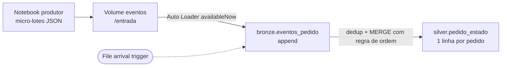

# C3: Eventos de pedidos de e-commerce em fluxo contínuo

**Situação:** não iniciado. Fazer depois do Lab 5 (Jobs).
**Seções do guia:** 2 (ingestão streaming e incremental), 3 (dedup) e 4 (file arrival trigger).
**Caderno de Estudos:** A4, A5 e A7.
**Questão do guia ligada:** 10 (processar arquivos logo após a chegada, sem compute ocioso).

## A história

A loja online publica um evento a cada mudança de pedido: `criado`, `pago`, `enviado`, `cancelado`. O sistema de origem tem dois defeitos conhecidos: às vezes **manda o mesmo evento duas vezes** e às vezes um evento **chega atrasado** (o `pago` aparece depois do `enviado`). O time de atendimento quer ver o estado atual de cada pedido, correto, poucos minutos depois do evento.

Na empresa isso viria de Kafka ou de um Event Hub. A Free Edition não tem broker, então o lab simula a fila com arquivos JSON chegando num volume. O consumo é o mesmo que se usa em produção para arquivo: Auto Loader.

## O que você vai treinar

- Produtor simulado que grava micro-lotes de eventos (com duplicado e atraso de propósito).
- Auto Loader com `trigger(availableNow=True)` lendo só os arquivos novos.
- Dedup por `event_id` e MERGE que **não deixa evento velho sobrescrever estado novo**.
- Job com **file arrival trigger** no volume.

## Arquitetura



## Fatos usados (conferidos)

- Volumes aceitam leitura e escrita com Python comum (`open`, `os`) no caminho `/Volumes/...` (learn.microsoft.com/azure/databricks/volumes/volume-files, 19/11/2026).
- Serverless só aceita `availableNow` (ou `Once`, deprecado) como trigger de streaming.
- File arrival trigger: monitora volume; sobrescrever arquivo existente **não** dispara; path sem wildcard.
- `MERGE` com eventos fora de ordem pode dar resultado errado; em pipeline declarativo o AUTO CDC trata isso com `SEQUENCE BY`. Aqui a regra de ordem é escrita à mão no `WHEN MATCHED AND`.

---

## Parte 1: o produtor de eventos

### Passo 1.1. Volume e pastas

- **Ação:** notebook `c3_produtor` (Python, Serverless), célula 1.
- **Por quê:** a pasta de chegada não pode conter o checkpoint (o Auto Loader leria os próprios arquivos de controle).
- **O que acontece:** cria o volume `eventos` e a pasta `entrada`. O controle fica no volume `ctrl` do Lab 2.
- **Conferência:** `os.listdir` da pasta mostra lista vazia.

```python
# Cria o volume de chegada dos eventos
spark.sql("CREATE VOLUME IF NOT EXISTS lab_de.bronze.eventos")
# Módulo padrão para pastas
import os
# Pasta onde os micro-lotes vão cair
entrada = "/Volumes/lab_de/bronze/eventos/entrada"
# Cria a pasta se não existir
os.makedirs(entrada, exist_ok=True)
# Confere que está vazia
print(os.listdir(entrada))
```

### Passo 1.2. Função que gera um micro-lote

- **Ação:** nova célula, colar e executar (só define a função).
- **Por quê:** um gerador controlado permite repetir o teste e provocar os defeitos de propósito.
- **O que acontece:** cada chamada grava um arquivo JSON Lines (um evento por linha) com nome único.
- **Conferência:** nada é impresso; a função fica disponível.

```python
# Bibliotecas padrão: JSON, aleatório, identificadores e datas
import json, random, uuid, datetime
# Ordem natural dos status de um pedido
STATUS = ["criado", "pago", "enviado", "cancelado"]
# UFs para o filtro por região do C5
UFS = ["PA", "MA", "TO", "SP"]
# Gera e grava um micro-lote; versao=1 é o formato normal (o C5 usa versao=2)
def gerar_lote(n_eventos=20, duplicar=2, atrasar=2, versao=1):
    # Lista de eventos deste lote
    eventos = []
    # Hora de referência do lote
    agora = datetime.datetime.now()
    # Cria n eventos novos
    for _ in range(n_eventos):
        # Pedido sorteado entre 50 possíveis (força várias mudanças no mesmo pedido)
        pedido = random.randint(1, 50)
        # Monta o evento no formato combinado com o "fornecedor"
        ev = {
            # Identificador único do evento (chave de dedup)
            "event_id": str(uuid.uuid4()),
            # Chave do pedido
            "order_id": pedido,
            # Novo status do pedido
            "status": random.choice(STATUS),
            # Momento em que o evento aconteceu na origem
            "event_ts": agora.isoformat(timespec="seconds"),
            # UF do cliente
            "uf": random.choice(UFS),
            # E-mail fictício (dado pessoal, usado no C5)
            "email_cliente": f"cliente{pedido}@exemplo.com",
        }
        # Versão 1: valor numérico; versão 2: campo renomeado e texto com R$ (defeito do C5)
        if versao == 1:
            # Valor do pedido como número
            ev["valor"] = round(random.uniform(20, 500), 2)
        # Caso contrário (versão 2 do fornecedor)
        else:
            # Fornecedor mudou o nome e o tipo sem avisar
            ev["valor_total"] = f"R$ {random.uniform(20, 500):.2f}".replace(".", ",")
        # Guarda o evento
        eventos.append(ev)
    # Defeito 1: repete alguns eventos idênticos (mesmo event_id)
    eventos += random.sample(eventos, k=min(duplicar, len(eventos)))
    # Defeito 2: alguns eventos chegam com horário antigo (atrasados)
    for ev in random.sample(eventos, k=min(atrasar, len(eventos))):
        # Volta o horário em 10 minutos
        ev["event_ts"] = (agora - datetime.timedelta(minutes=10)).isoformat(timespec="seconds")
    # Nome único do arquivo (data, hora e um sufixo aleatório)
    nome = f"lote_{agora:%Y%m%d_%H%M%S}_{uuid.uuid4().hex[:6]}.json"
    # Grava um evento por linha (JSON Lines)
    with open(f"{entrada}/{nome}", "w", encoding="utf-8") as f:
        # Uma linha por evento
        f.write("\n".join(json.dumps(e, ensure_ascii=False) for e in eventos))
    # Devolve o nome e a quantidade para conferência
    return nome, len(eventos)
```

### Passo 1.3. Gerar 3 lotes

```python
# Gera 3 micro-lotes seguidos
for _ in range(3):
    # Mostra nome do arquivo e número de linhas (esperado 22 por lote: 20 + 2 duplicados)
    print(gerar_lote())
```

- **Conferência:** 3 nomes de arquivo, cada um com 22 eventos.

### Passo 1.4. Ver os dados reais

```sql
-- Lê os arquivos como texto para ver uma linha crua de cada
SELECT value, _metadata.file_name FROM read_files('/Volumes/lab_de/bronze/eventos/entrada/', format => 'text') LIMIT 5;
```

**Entrega da parte 1:** cole a saída do passo 1.3 e as 5 linhas.

---

## Parte 2: bronze com Auto Loader

- **Ação:** notebook `c3_bronze` (Python), colar e executar.
- **Por quê:** ler só o que chegou desde a última execução, com contrato de tipos.
- **O que acontece:** o checkpoint guarda quais arquivos já foram lidos; `availableNow` processa o que há e para.
- **Conferência:** a tabela tem 66 linhas (3 x 22). Rodar de novo sem lote novo não muda a contagem.

```python
# Funções de coluna
from pyspark.sql import functions as F
# Pasta de controle fora da pasta de chegada
ctrl = "/Volumes/lab_de/bronze/ctrl/eventos_pedido"
# Lê os eventos em streaming com Auto Loader
df = (spark.readStream.format("cloudFiles")
      # Arquivos JSON Lines
      .option("cloudFiles.format", "json")
      # Onde o schema inferido fica guardado
      .option("cloudFiles.schemaLocation", f"{ctrl}/schema")
      # Contrato: tipos esperados; o que não couber vai para _rescued_data
      .option("cloudFiles.schemaHints", "order_id INT, event_ts TIMESTAMP, valor DOUBLE")
      # Pasta de chegada
      .load("/Volumes/lab_de/bronze/eventos/entrada/")
      # Auditoria: arquivo de origem
      .withColumn("arquivo_origem", F.col("_metadata.file_path"))
      # Auditoria: hora da ingestão
      .withColumn("ingerido_em", F.current_timestamp()))
# Grava em append na bronze
(df.writeStream
   # Checkpoint: memória do que já foi processado
   .option("checkpointLocation", f"{ctrl}/checkpoint")
   # Processa o disponível e para (serverless)
   .trigger(availableNow=True)
   # Tabela destino
   .toTable("lab_de.bronze.eventos_pedido")
   # Espera terminar antes da próxima célula
   .awaitTermination())
# Conferência: total na bronze
print(spark.table("lab_de.bronze.eventos_pedido").count())
```

---

## Parte 3: silver com dedup e regra de ordem

### Passo 3.1. Criar a silver

```sql
-- Estado atual de cada pedido
CREATE TABLE IF NOT EXISTS lab_de.silver.pedido_estado (
  -- Chave do pedido
  order_id INT NOT NULL,
  -- Último status conhecido
  status STRING,
  -- Valor do pedido
  valor DOUBLE,
  -- UF do cliente
  uf STRING,
  -- E-mail do cliente (dado pessoal)
  email_cliente STRING,
  -- Momento do evento que gerou este estado
  event_ts TIMESTAMP,
  -- Evento que gerou este estado
  event_id STRING,
  -- Quando a silver foi alterada
  atualizado_em TIMESTAMP
);
```

### Passo 3.2. MERGE com dedup e proteção contra atraso

- **Por quê:** sem o `AND s.event_ts > t.event_ts`, um evento atrasado apagaria um estado mais novo.
- **Conferência:** total da silver = número de pedidos distintos na bronze; nenhum pedido com `event_ts` menor que o maior `event_ts` dele na bronze.

```sql
-- Aplica os eventos da bronze na silver
MERGE INTO lab_de.silver.pedido_estado AS t
-- Origem: um evento por pedido, o mais recente, sem duplicados
USING (
  -- Colunas do estado
  SELECT order_id, status, valor, uf, email_cliente, event_ts, event_id
  -- Primeiro remove eventos repetidos (mesmo event_id)
  FROM (SELECT DISTINCT order_id, status, valor, uf, email_cliente, event_ts, event_id FROM lab_de.bronze.eventos_pedido)
  -- Depois fica com o evento mais recente de cada pedido (event_id desempata horários iguais)
  QUALIFY ROW_NUMBER() OVER (PARTITION BY order_id ORDER BY event_ts DESC, event_id DESC) = 1
-- Fecha a subconsulta e dá o apelido s à origem
) AS s
-- Chave: o pedido
ON t.order_id = s.order_id
-- Só atualiza se o evento for mais novo que o estado atual (protege contra atraso)
WHEN MATCHED AND s.event_ts > t.event_ts THEN
  -- Troca o estado
  UPDATE SET status = s.status, valor = s.valor, uf = s.uf, email_cliente = s.email_cliente,
             -- Continua a lista de colunas atualizadas
             event_ts = s.event_ts, event_id = s.event_id, atualizado_em = current_timestamp()
-- Pedido novo
WHEN NOT MATCHED THEN
  -- Insere o estado
  INSERT (order_id, status, valor, uf, email_cliente, event_ts, event_id, atualizado_em)
  -- Valores da origem
  VALUES (s.order_id, s.status, s.valor, s.uf, s.email_cliente, s.event_ts, s.event_id, current_timestamp());
```

### Passo 3.3. Provar que funcionou

```sql
-- Eventos repetidos na bronze (esperado: maior que zero, porque o produtor duplica)
SELECT COUNT(*) - COUNT(DISTINCT event_id) AS duplicados_bronze FROM lab_de.bronze.eventos_pedido;
-- Pedidos na silver com estado mais velho que o último evento (esperado: 0)
SELECT COUNT(*) AS estados_errados
-- Silver
FROM lab_de.silver.pedido_estado t
-- Maior horário de evento por pedido na bronze
JOIN (SELECT order_id, MAX(event_ts) AS max_ts FROM lab_de.bronze.eventos_pedido GROUP BY order_id) b USING (order_id)
-- Estado ficou para trás
WHERE t.event_ts < b.max_ts;
```

---

## Parte 4: orquestrar com file arrival trigger

1. **Ação:** Job `c3_pedidos` com 2 tarefas: `bronze` (notebook `c3_bronze`) e `silver` (o MERGE do passo 3.2 num notebook SQL ou tarefa SQL), `silver` dependendo de `bronze`.
   - **Conferência:** DAG com as duas tarefas em sequência.
   - Na tarefa `bronze`, **Retries: 1**. Por quê: a documentação diz que a evolução de schema no streaming pressupõe retries para o job seguir (learn.microsoft.com/azure/databricks/jobs/control-flow). O C5 mostra isso na prática.
2. **Ação:** Schedules & Triggers, **File arrival**, caminho `/Volumes/lab_de/bronze/eventos/entrada/`.
   - **Por quê:** roda só quando chega arquivo; não há compute parado nem run vazio (questão 10 do guia).
   - **Conferência:** banner com "Trigger status ... No new files found".
3. **Ação:** no `c3_produtor`, rodar `gerar_lote()` uma vez e esperar.
   - **Conferência:** aparece um run com `Launched: By file arrival` e a bronze cresce 22 linhas.
4. **Ação:** teste negativo: sobrescrever um arquivo já existente com o mesmo nome.
   - **Conferência:** nenhum run novo (sobrescrita não dispara).
5. **Ação:** **pausar** o trigger.

## Parte 5: perguntas de prova

1. Quer processar arquivos logo que chegam no volume, sem cluster parado e sem run vazio. Qual trigger? (a) Scheduled a cada minuto (b) Continuous (c) File arrival (d) Manual
2. Verdadeiro ou falso: num MERGE sem condição de ordem, um evento atrasado pode sobrescrever um estado mais recente.
3. Num notebook serverless, qual trigger de streaming funciona? (a) `processingTime="10 seconds"` (b) `continuous="1 second"` (c) `availableNow=True` (d) sem trigger
