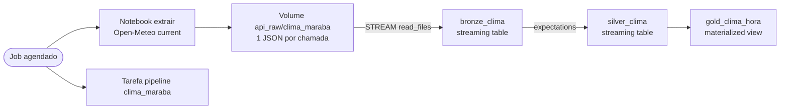

# C4: Clima de Marabá quase em tempo real (Job agendado + pipeline declarativo)

**Situação:** não iniciado. Fazer junto ou depois do Lab 4 (pipeline declarativo).
**Seções do guia:** 3 (objetos gold, qualidade), 4 (Job com tarefa de pipeline, schedule) e 6 (duração e thresholds).
**Caderno de Estudos:** A6, A7 e A9.
**Questão do guia ligada:** 9 (threshold de duração da tarefa).

## A história

Uma equipe de campo em Marabá programa serviço externo conforme chuva e calor. Ela quer um painel com a condição do tempo atualizada várias vezes por dia e a média por hora. A fonte é uma API pública de previsão. O painel não pode mostrar leitura absurda (umidade acima de 100%, por exemplo) e o time de dados quer ser avisado se a carga começar a demorar.

## O que você vai treinar

- Buscar coordenadas oficiais do município (API de Malhas do IBGE) e a condição atual (Open-Meteo).
- Job com 2 tarefas: notebook que chama a API e **tarefa de pipeline**.
- Pipeline declarativo: streaming table na bronze, expectations na silver, materialized view na gold.
- Schedule e **Metric thresholds** (Warning e Timeout).

## Arquitetura



## Fontes (conferidas)

- IBGE Malhas v4: `/api/v4/malhas/municipios/{id}/metadados` traz id, nível geográfico, **centroide**, regiões limítrofes e área (skill ibge-apis-docs, 24/10/2026). Marabá = 1504208.
- Open-Meteo (open-meteo.com/en/docs, 19/11/2026): endpoint `https://api.open-meteo.com/v1/forecast`; `current` recebe a lista de variáveis da condição atual e aceita qualquer variável horária; o objeto `current` da resposta traz `time` e `interval` (segundos) e cada variável como número; condição atual baseada em dado de modelo de 15 em 15 minutos; `timezone` padrão GMT, aceita nome do tz database ou `auto`. Uso não comercial sem chave; uso comercial exige `apikey`. **Limites de requisição não constam na página.**
- Nomes de variáveis (`temperature_2m`, `relative_humidity_2m`, `precipitation`, `wind_speed_10m`): aparecem nos exemplos da própria página; confirme na resposta real.
- Free Edition: 1 pipeline ativo por tipo; 5 tarefas de job concorrentes.

---

## Parte 0: internet de saída

Teste do C1 (passo 0.2) com a URL `https://servicodados.ibge.gov.br/api/v4/malhas/municipios/1504208/metadados`. Sem rede, use o plano B.

## Parte 1: coordenadas e primeira leitura

### Passo 1.1. Centroide de Marabá

- **Ação:** notebook `c4_extrair` (Python), célula 1.
- **Por quê:** usar coordenada oficial em vez de digitar de memória.
- **O que acontece:** chama a API de Malhas e mostra o JSON.
- **Conferência:** aparece um campo `centroide` com longitude e latitude. Anote os nomes exatos.

```python
# HTTP e JSON da biblioteca padrão
import urllib.request, json
# Metadados da malha de Marabá (centroide, área, limítrofes)
url = "https://servicodados.ibge.gov.br/api/v4/malhas/municipios/1504208/metadados"
# Chama a API
with urllib.request.urlopen(url, timeout=30) as resp:
    # Converte a resposta em objeto Python
    meta = json.loads(resp.read().decode("utf-8"))
# Mostra o JSON formatado para ler os nomes dos campos
print(json.dumps(meta, indent=2, ensure_ascii=False)[:1500])
```

### Passo 1.2. Chamar a condição atual e gravar

Ajuste `LAT` e `LON` com os valores do passo 1.1.

```python
# Bibliotecas padrão
import urllib.request, datetime, os
# Latitude do centroide (troque pelo valor do passo 1.1)
LAT = -5.0
# Longitude do centroide (troque pelo valor do passo 1.1)
LON = -49.0
# Variáveis da condição atual pedidas à API
VARS = "temperature_2m,relative_humidity_2m,precipitation,wind_speed_10m"
# URL do endpoint de previsão com fuso de São Paulo
url = (f"https://api.open-meteo.com/v1/forecast?latitude={LAT}&longitude={LON}"
       # Lista de variáveis atuais e fuso horário
       f"&current={VARS}&timezone=America/Sao_Paulo")
# Pasta da fonte no volume
pasta = "/Volumes/lab_de/bronze/api_raw/clima_maraba"
# Cria a pasta se não existir
os.makedirs(pasta, exist_ok=True)
# Chama a API
with urllib.request.urlopen(url, timeout=30) as resp:
    # Resposta como texto (um objeto JSON numa linha)
    corpo = resp.read().decode("utf-8")
# Nome do arquivo com data e hora da chamada
destino = f"{pasta}/clima_{datetime.datetime.now():%Y%m%d_%H%M%S}.json"
# Grava a resposta bruta
with open(destino, "w", encoding="utf-8") as f:
    # Uma linha, um objeto: o pipeline lê como JSON Lines
    f.write(corpo.strip())
# Mostra o caminho e a resposta
print(destino, corpo)
```

- **Conferência:** o JSON tem um objeto `current` com `time`, `interval` e as 4 variáveis. Anote as unidades se a resposta trouxer um bloco de unidades.

**Entrega da parte 1:** cole os dois JSON.

---

## Parte 2: o pipeline declarativo (conferir nomes com a parte 1)

### Passo 2.1. Criar o pipeline

- **Ação:** Jobs & Pipelines, Create, pipeline ETL (registre o nome exato do botão que aparecer), nome `clima_maraba`, catálogo `lab_de`, schema `silver`, serverless. Criar o arquivo `clima_maraba.sql` na pasta de código do pipeline.
- **Por quê:** a criação do pipeline sem bundle é pela interface; o código é script.
- **Conferência:** o pipeline aparece com o arquivo `.sql` (sem extensão, o pipeline não executa o arquivo).

### Passo 2.2. Código `clima_maraba.sql`

```sql
-- Bronze: lê só os arquivos novos do volume (Auto Loader por baixo do read_files)
CREATE OR REFRESH STREAMING TABLE bronze_clima
-- Comentário da tabela no catálogo
COMMENT 'Respostas brutas da Open-Meteo, uma linha por chamada'
-- STREAM obrigatório para streaming table; JSON de uma linha por arquivo
AS SELECT *, _metadata.file_path AS arquivo_origem
-- Pasta onde o notebook grava
FROM STREAM read_files('/Volumes/lab_de/bronze/api_raw/clima_maraba/', format => 'json');

-- Silver: colunas achatadas e regras de qualidade
CREATE OR REFRESH STREAMING TABLE silver_clima (
  -- Umidade fora de 0 a 100 é leitura impossível: descarta a linha
  CONSTRAINT umidade_valida EXPECT (umidade_2m BETWEEN 0 AND 100) ON VIOLATION DROP ROW,
  -- Sem horário não há como agregar por hora: descarta
  CONSTRAINT tem_horario EXPECT (medido_em IS NOT NULL) ON VIOLATION DROP ROW,
  -- Temperatura estranha só vira métrica (mantém a linha para investigar)
  CONSTRAINT temperatura_plausivel EXPECT (temperatura_2m BETWEEN 10 AND 45)
)
-- Achata o objeto current; crase porque current é palavra-chave do SQL (ajuste os nomes à parte 1)
AS SELECT
  -- Horário da leitura
  to_timestamp(`current`.time) AS medido_em,
  -- Temperatura a 2 metros
  `current`.temperature_2m AS temperatura_2m,
  -- Umidade relativa a 2 metros
  `current`.relative_humidity_2m AS umidade_2m,
  -- Precipitação
  `current`.precipitation AS precipitacao,
  -- Vento a 10 metros
  `current`.wind_speed_10m AS vento_10m,
  -- Rastro do arquivo
  arquivo_origem
-- Lê a bronze em streaming
FROM STREAM(bronze_clima);

-- Gold: média por hora para o painel (leitura batch da silver)
CREATE OR REFRESH MATERIALIZED VIEW gold_clima_hora
-- Comentário da tabela
COMMENT 'Média por hora; leituras repetidas do mesmo horário contam uma vez'
-- Agrega por hora cheia
AS SELECT date_trunc('HOUR', medido_em) AS hora,
  -- Temperatura média da hora
  AVG(temperatura_2m) AS temperatura_media,
  -- Umidade média da hora
  AVG(umidade_2m) AS umidade_media,
  -- Soma da precipitação da hora
  SUM(precipitacao) AS precipitacao_total,
  -- Quantas leituras distintas entraram na média
  COUNT(*) AS leituras
-- Remove chamadas repetidas que devolveram o mesmo horário de modelo
FROM (SELECT DISTINCT medido_em, temperatura_2m, umidade_2m, precipitacao FROM silver_clima)
-- Uma linha por hora
GROUP BY date_trunc('HOUR', medido_em);
```

### Passo 2.3. Executar e ler as métricas

- **Ação:** Start no pipeline; depois do fim, abrir `silver_clima` no grafo e a aba de qualidade de dados.
- **Conferência:** as 3 tabelas aparecem no grafo; a silver mostra 0 linhas descartadas (dado real costuma ser válido).

### Passo 2.4. Provocar violação

```python
# Grava uma leitura falsa com umidade impossível, como se a API tivesse errado
falso = '{"current":{"time":"2026-11-19T15:00","interval":900,"temperature_2m":60,"relative_humidity_2m":150,"precipitation":0,"wind_speed_10m":5}}'
# Arquivo novo na pasta observada
with open("/Volumes/lab_de/bronze/api_raw/clima_maraba/clima_teste_violacao.json", "w") as f:
    # Uma linha JSON
    f.write(falso)
```

- **Ação:** rodar o pipeline de novo.
- **Conferência:** `umidade_valida` mostra 1 linha descartada; `temperatura_plausivel` não descarta (a linha já saiu pela regra de umidade). Para ver a métrica de temperatura, grave outra leitura com umidade 50 e temperatura 60.

---

## Parte 3: o Job

1. **Ação:** Job `c4_clima`: tarefa `extrair` (notebook `c4_extrair`, só o passo 1.2) e tarefa `pipeline` do tipo **Pipeline** apontando para `clima_maraba`, dependendo de `extrair`.
   - **Conferência:** DAG com notebook e pipeline.
2. **Ação:** Schedule a cada 30 minutos.
   - **Por quê:** a condição atual vem de modelo de 15 em 15 minutos; consultar mais que isso só repete dado.
   - **Conferência:** próximo horário aparece no job.
3. **Ação:** na tarefa `pipeline`, **Metric thresholds**, `Run duration`: Warning 5 min, Timeout 15 min.
   - **Por quê:** Warning avisa e deixa rodar; Timeout cancela (questão 9 do guia: subir o threshold quando o tempo normal passou a ser maior).
   - **Conferência:** a tarefa mostra os dois limites.
4. **Ação:** deixar rodar 2 ou 3 vezes, conferir `gold_clima_hora` e **pausar** o schedule.
   - **Conferência:** a gold tem pelo menos 1 hora com `leituras` maior ou igual a 1.

## Parte 4: perguntas de prova

1. A tarefa do pipeline passou a levar 12 min e o Timeout está em 10 min. O tempo maior é esperado. O que fazer? (a) desligar retries (b) subir o Timeout threshold da tarefa (c) trocar para Continuous (d) apagar o checkpoint
2. Verdadeiro ou falso: `CONSTRAINT x EXPECT (cond)` sem `ON VIOLATION` mantém a linha e só registra a métrica.
3. Onde fica a agregação por hora sobre uma fonte streaming? (a) streaming table com GROUP BY (b) materialized view com leitura batch (c) temporary view (d) tabela com INSERT a cada run

## Plano B (sem internet de saída)

Rodar a chamada no Windows e subir o arquivo; o pipeline continua igual.

```powershell
# Troque pelos valores do centroide
$lat = -5.0; $lon = -49.0
# URL da condição atual com fuso de São Paulo
$url = "https://api.open-meteo.com/v1/forecast?latitude=$lat&longitude=$lon&current=temperature_2m,relative_humidity_2m,precipitation,wind_speed_10m&timezone=America/Sao_Paulo"
# Chama a API
$r = Invoke-WebRequest -Uri $url
# Nome do arquivo com data e hora
$arq = "clima_$(Get-Date -Format yyyyMMdd_HHmmss).json"
# Grava em UTF-8 sem BOM
[System.IO.File]::WriteAllText("$PWD\$arq", $r.Content)
# Sobe para o volume (prefixo dbfs:/ obrigatório na CLI)
databricks fs cp $arq "dbfs:/Volumes/lab_de/bronze/api_raw/clima_maraba/$arq"
```

Sem a tarefa `extrair`, o Job fica só com a tarefa de pipeline. Agende no Windows (Agendador de Tarefas) se quiser simular a frequência.
