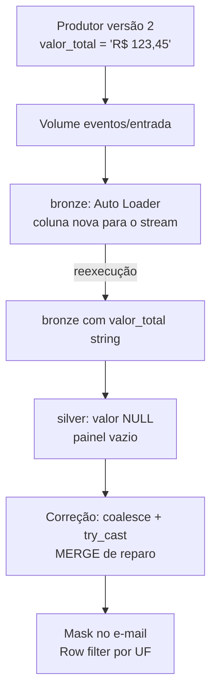

# C5: Incidente de segunda-feira: o fornecedor mudou o formato e o jurídico pediu sigilo

**Situação:** não iniciado. Pré-requisitos: C3 concluído (job `c3_pedidos`) e os 2 grupos do Lab 8 (`analistas` e `financeiro`).
**Seções do guia:** 6 (falhas, run history), 7 (column mask e row filter por grupo) e 2 (evolução de schema).
**Caderno de Estudos:** A9, A10 e A4.
**Questão do guia ligada:** 7 (só um grupo vê o dado sensível completo).

## A história

Segunda-feira, 8h. O atendimento avisa que o valor dos pedidos novos sumiu do painel. O job `c3_pedidos` falhou de madrugada e, depois de uma nova execução, "funcionou", mas os valores vieram vazios. O fornecedor do e-commerce trocou o campo `valor` (número) por `valor_total` (texto no formato `R$ 123,45`) e não avisou ninguém.

No mesmo dia o jurídico manda um e-mail: pela LGPD, o e-mail do cliente só pode aparecer completo para o financeiro, e os analistas regionais só podem ver pedidos do Pará.

Você precisa: achar a causa, corrigir sem perder evento, reprocessar o que entrou errado, aplicar a regra do jurídico e escrever um postmortem curto.

## O que você vai treinar

- Ler a falha no run history e na mensagem exata do erro.
- Entender o comportamento do Auto Loader diante de coluna nova (`addNewColumns` para o stream).
- Corrigir a transformação e reprocessar só o que ficou errado.
- **Column mask** e **row filter** com `is_account_group_member`.
- Postmortem: causa, impacto, correção, prevenção.

## Arquitetura do incidente



## Fatos usados (conferidos)

- Auto Loader sem `schemaEvolutionMode` informado: `addNewColumns`, que adiciona a coluna e **para** o stream com `UnknownFieldException`; a reexecução segue com o schema novo (learn.microsoft.com/azure/databricks/ingestion/cloud-object-storage/auto-loader/schema; visto no Lab 2).
- Status de run: Queued, Pending, Running, Skipped, Succeeded, Succeeded with failures, Failed, Timed Out, Canceling, Canceled; histórico de 60 dias; a aba Runs mostra os "Top 5 error types" (learn.microsoft.com/azure/databricks/jobs/monitor, 19/11/2026).
- Retries: a documentação diz que a evolução de schema com Structured Streaming **pressupõe** que o job rode com retries, para reiniciar o ambiente e seguir (learn.microsoft.com/azure/databricks/jobs/control-flow, 19/11/2026). Com retry na tarefa `bronze`, o job "se cura" sozinho e a falha só aparece no histórico da tentativa.
- Repair run: reexecuta só as tarefas sem sucesso e as dependentes; só existe em job com 2 ou mais tarefas (job de 1 tarefa usa Run now); cada tarefa reparada roda **do início**, e o Lakeflow Jobs não torna a tarefa idempotente: use overwrite ou MERGE onde duplicar for problema (learn.microsoft.com/azure/databricks/jobs/repair-job-failures, 19/11/2026).
- `try_cast` devolve NULL em vez de erro quando o valor não converte (learn.microsoft.com/azure/databricks/sql/language-manual/functions/try_cast, 19/11/2026).
- Uma tabela tem no máximo 1 row filter; para apagar a função, tire antes o filtro ou a máscara.
- Ler tabela exige `USE CATALOG`, `USE SCHEMA` e `SELECT`.

---

## Parte 1: provocar o incidente

- **Ação:** no notebook `c3_produtor` (o do C3), rodar as células 1 e 2 e depois esta.
- **Por quê:** simular o fornecedor mandando o formato novo.
- **Conferência:** 2 arquivos novos de 22 eventos cada.

```python
# Dois micro-lotes no formato novo do fornecedor (valor_total em texto)
for _ in range(2):
    # Mostra o arquivo criado e o número de eventos
    print(gerar_lote(versao=2))
```

Se o file arrival trigger do C3 estiver pausado, rode o job `c3_pedidos` à mão (Run now).

## Parte 2: diagnosticar

### Passo 2.1. Ler a falha

- **Ação:** Jobs & Pipelines, `c3_pedidos`, aba Runs, abrir o run mais recente e clicar na tarefa `bronze`.
- **Por quê:** o diagnóstico começa pela mensagem exata, não por palpite.
- **O que acontece:** com Retries 1 (configurado no C3), a primeira tentativa falha e a segunda passa; o run pode terminar `Succeeded` e a falha fica só no histórico da tarefa. Sem retries, o run fica `Failed`.
- **Conferência:** numa das tentativas, erro com `UNKNOWN_FIELD_EXCEPTION` e o campo `valor_total`. Cole a mensagem no chat.

### Passo 2.2. Reexecutar e ver o efeito (só se o run ficou Failed)

- **Ação:** no run com falha, **Repair run** (reexecuta só as tarefas sem sucesso e as dependentes).
- **Conferência:** o run fica `Succeeded`. Esse é o "funcionou" da história: o job passou, mas o dado ficou errado.

### Passo 2.3. Medir o estrago na silver

```sql
-- Pedidos com valor vazio por arquivo de origem do evento vigente
SELECT b.arquivo_origem, count_if(s.valor IS NULL) AS sem_valor, COUNT(*) AS total
-- Silver (estado atual)
FROM lab_de.silver.pedido_estado s
-- Liga cada estado ao evento que o gerou
JOIN lab_de.bronze.eventos_pedido b ON s.event_id = b.event_id
-- Um resultado por arquivo
GROUP BY b.arquivo_origem
-- Arquivos mais novos primeiro
ORDER BY b.arquivo_origem DESC;
```

- **Conferência:** os 2 arquivos novos aparecem com `sem_valor` igual ao total; os antigos com 0.

### Passo 2.4. Confirmar a causa na bronze

```sql
-- Mostra as colunas atuais da bronze (deve aparecer valor_total como string)
DESCRIBE TABLE lab_de.bronze.eventos_pedido;
-- Exemplos do formato novo
SELECT event_id, valor, valor_total FROM lab_de.bronze.eventos_pedido WHERE valor_total IS NOT NULL LIMIT 5;
```

- **Conferência:** `valor` nulo e `valor_total` com texto `R$ 123,45`.

### Passo 2.5. Olhar pela system table (se houver acesso)

```sql
-- Mostra as colunas disponíveis antes de filtrar (a tabela ganhou colunas em dez/2025)
DESCRIBE TABLE system.lakeflow.job_run_timeline;
```

Se der erro de permissão: o acesso exige `USE` e `SELECT` nos system schemas ou ser admin. Registre e siga pela UI.

## Parte 3: corrigir e reprocessar

### Passo 3.1. MERGE de reparo

- **Por quê:** o MERGE do C3 só atualiza se o evento for **mais novo**. Os estados com valor vazio vieram do mesmo evento, então ele não os corrigiria. O reparo precisa de uma condição a mais.
- **O que acontece:** converte o texto em número e corrige também os estados já gravados com valor vazio.
- **Conferência:** rodando o 2.3 de novo, `sem_valor = 0` em todos os arquivos.

```sql
-- Reaplica os eventos na silver com a regra nova de valor
MERGE INTO lab_de.silver.pedido_estado AS t
-- Origem: evento mais recente por pedido, sem duplicados, com valor normalizado
USING (
  -- Escolhe o valor numérico; se faltar, converte o texto do formato novo
  SELECT order_id, status,
         -- 'R$ 123,45' vira 123.45; try_cast devolve NULL em vez de falhar se o texto vier errado
         coalesce(valor, try_cast(replace(replace(valor_total, 'R$ ', ''), ',', '.') AS DOUBLE)) AS valor,
         -- Demais colunas do estado
         uf, email_cliente, event_ts, event_id
  -- Remove eventos repetidos
  FROM (SELECT DISTINCT order_id, status, valor, valor_total, uf, email_cliente, event_ts, event_id FROM lab_de.bronze.eventos_pedido)
  -- Evento mais recente de cada pedido
  QUALIFY ROW_NUMBER() OVER (PARTITION BY order_id ORDER BY event_ts DESC, event_id DESC) = 1
-- Fecha a subconsulta e dá o apelido s à origem
) AS s
-- Chave: o pedido
ON t.order_id = s.order_id
-- Atualiza se o evento for mais novo OU se for o mesmo evento gravado com valor vazio (reparo)
WHEN MATCHED AND (s.event_ts > t.event_ts OR (s.event_id = t.event_id AND t.valor IS NULL)) THEN
  -- Troca o estado
  UPDATE SET status = s.status, valor = s.valor, uf = s.uf, email_cliente = s.email_cliente,
             -- Continua a lista de colunas atualizadas
             event_ts = s.event_ts, event_id = s.event_id, atualizado_em = current_timestamp()
-- Pedido novo
WHEN NOT MATCHED THEN
  -- Insere
  INSERT (order_id, status, valor, uf, email_cliente, event_ts, event_id, atualizado_em)
  -- Valores da origem
  VALUES (s.order_id, s.status, s.valor, s.uf, s.email_cliente, s.event_ts, s.event_id, current_timestamp());
```

Depois de validar, troque o MERGE da tarefa `silver` do job por este, para os próximos lotes.

### Passo 3.2. Alarme para a próxima vez

```python
# Conta estados sem valor na silver
sem_valor = spark.sql("SELECT count_if(valor IS NULL) AS n FROM lab_de.silver.pedido_estado").first()["n"]
# Falha a tarefa de propósito se houver estado sem valor (o job fica Failed e notifica)
if sem_valor > 0:
    # Mensagem clara para quem abrir o run
    raise ValueError(f"Qualidade: {sem_valor} pedidos sem valor na silver")
```

- **Ação:** adicionar como tarefa `checa_qualidade` depois de `silver` e configurar notificação de falha por e-mail no job.
- **Conferência:** a tarefa passa (0 sem valor).

## Parte 4: regra do jurídico

Pré-requisito: grupos `analistas` e `financeiro` em Settings, Identity and access, com seu usuário em **um** deles.

### Passo 4.1. Máscara no e-mail

```sql
-- Função de máscara: financeiro vê o e-mail; os demais só o domínio
CREATE OR REPLACE FUNCTION lab_de.silver.mascara_email(email STRING)
-- Retorna o valor que o usuário vai ver
RETURN CASE WHEN is_account_group_member('financeiro') THEN email
            -- Esconde a parte antes do arroba
            ELSE concat('***', substring(email, instr(email, '@'))) END;
-- Liga a máscara na coluna da silver
ALTER TABLE lab_de.silver.pedido_estado ALTER COLUMN email_cliente SET MASK lab_de.silver.mascara_email;
```

### Passo 4.2. Filtro de linhas por UF

```sql
-- Função de filtro: financeiro vê todas as UFs; os demais só o Pará
CREATE OR REPLACE FUNCTION lab_de.silver.filtro_uf_pedido(uf STRING)
-- true = a linha aparece para o usuário
RETURN IF(is_account_group_member('financeiro'), true, uf = 'PA');
-- Liga o filtro (no máximo 1 row filter por tabela)
ALTER TABLE lab_de.silver.pedido_estado SET ROW FILTER lab_de.silver.filtro_uf_pedido ON (uf);
```

### Passo 4.3. Provar

```sql
-- O que você vê agora depende do seu grupo
SELECT uf, COUNT(*) AS pedidos, MIN(email_cliente) AS exemplo_email
-- Silver com máscara e filtro
FROM lab_de.silver.pedido_estado
-- Uma linha por UF visível
GROUP BY uf;
```

- **Conferência no grupo `analistas`:** só a linha `PA` e e-mail no formato `***@exemplo.com`.
- **Conferência no grupo `financeiro`:** as 4 UFs e o e-mail completo.
- Troque seu usuário de grupo e rode de novo (a mudança de grupo pode levar alguns instantes).

## Parte 5: postmortem (preencher)

| Item | Resposta |
|---|---|
| O que aconteceu | |
| Impacto (quantos pedidos, por quanto tempo) | |
| Causa raiz | |
| Como foi detectado | |
| Correção aplicada | |
| Prevenção (escolha e justifique) | contrato com o fornecedor; `schemaEvolutionMode` diferente; expectation ou tarefa de qualidade; alerta de falha |

## Parte 6: perguntas de prova

1. Só o financeiro pode ver o e-mail completo. Qual recurso do Unity Catalog? (a) row filter (b) column mask com função por grupo (c) `REVOKE SELECT` na tabela (d) view materializada
2. Verdadeiro ou falso: com o modo padrão `addNewColumns`, o Auto Loader adiciona a coluna nova ao schema e para o stream; a próxima execução segue normalmente.
3. Um job falhou na terceira de cinco tarefas. Qual opção reexecuta só o que falhou e as seguintes? (a) Run now (b) Repair run (c) apagar o checkpoint (d) full refresh

## Limpeza (opcional, depois de estudar)

```sql
-- Tira o filtro antes de apagar a função (senão a tabela fica inacessível)
ALTER TABLE lab_de.silver.pedido_estado DROP ROW FILTER;
-- Tira a máscara antes de apagar a função
ALTER TABLE lab_de.silver.pedido_estado ALTER COLUMN email_cliente DROP MASK;
```
