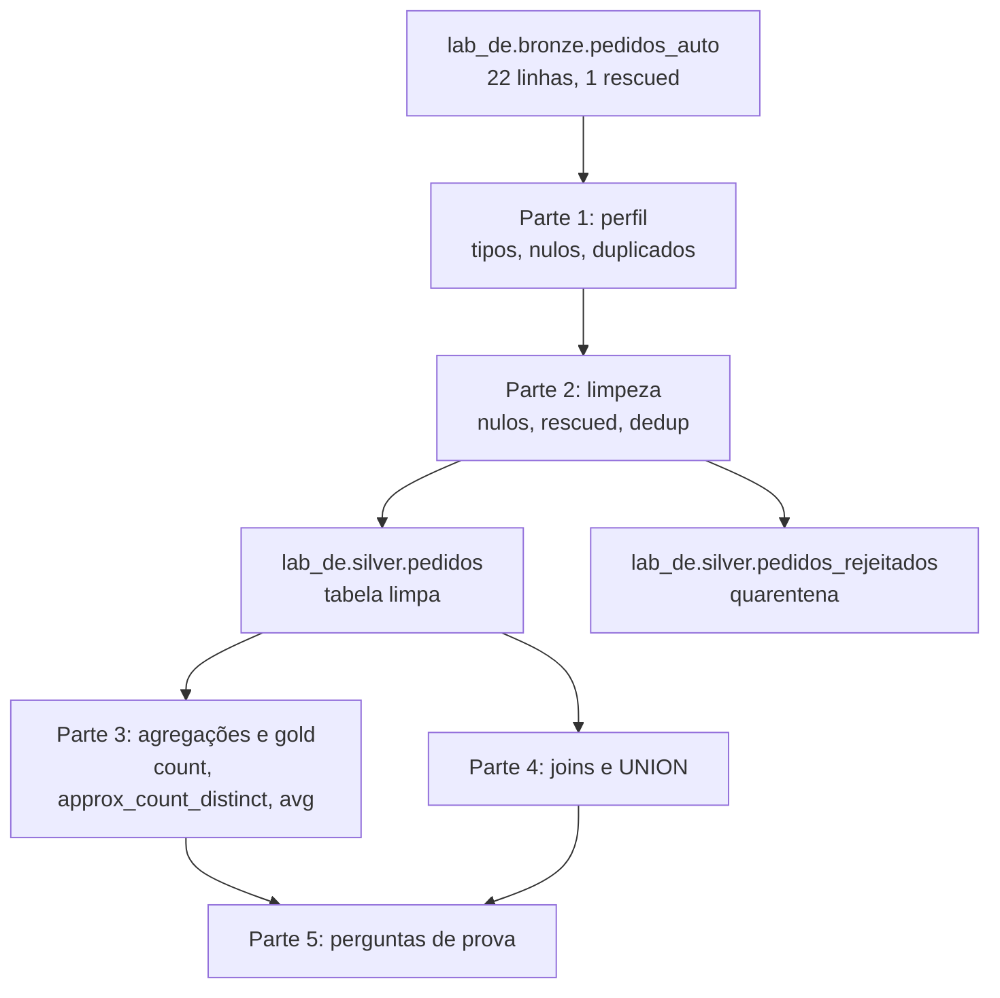

# Lab 3: Transformação (bronze para silver e gold)

**Situação:** em andamento. Parte 1 entregue em 19/11/2026, **aguardando o resultado**.
**Seção do guia:** 3, Data Transformation & Modeling (**22%**, a maior da prova).
**Caderno de Estudos:** A3, A5 e A6.
**Fonte:** `lab_de.bronze.pedidos_auto` (22 linhas, do Lab 2).

## Conceito (2 min)

A seção 3 cobra:

- limpar a bronze (nulos, tipos) e gravar a silver;
- joins: inner, left, broadcast, multi-chave, cross, union e union all;
- adicionar, remover, dividir e renomear colunas, filtrar, reestruturar, explode;
- deduplicar e agregar: count, approx count distinct, mean e summary;
- objetos gold (materialized view, view, streaming table, tabela);
- checagens de qualidade em silver e gold.

Regra do lab: a limpeza só é escrita depois de ver os dados reais. Por isso a parte 1 só lê e mede.

## Diagrama



## Partes

| Parte | Tema | Situação |
|---|---|---|
| 1 | Perfil dos dados reais | Entregue, aguardando resultado |
| 2 | Limpeza bronze para silver, quarentena e constraints | Escrita depois do resultado da parte 1 |
| 3 | Agregações e objetos gold | Planejada |
| 4 | Joins e set operators | Planejada |
| 5 | Perguntas de prova e fechamento | Planejada |

---

## Parte 1: conhecer os dados reais

### Passo 1. Criar o notebook do lab

- **Ação:** no menu lateral, New, Notebook. Renomear para `lab3_transformacao`, linguagem padrão **SQL**, conectar em **Serverless**.
- **Por quê:** na prova, o código de manipulação de dados aparece em SQL quando possível.
- **O que acontece:** abre um notebook vazio com uma célula SQL.
- **Conferência:** o seletor de linguagem mostra SQL e o de compute mostra Serverless conectado.

### Passo 2. Ver o schema real (célula 1)

- **Ação:** colar na célula 1 e executar (Shift+Enter).
- **Por quê:** a limpeza da parte 2 vai usar os nomes e tipos exatos.
- **O que acontece:** lê só os metadados da tabela no Unity Catalog; os dados não são lidos.
- **Conferência:** uma linha por coluna. Pelo Lab 2 devem aparecer pelo menos `pedido_id int`, `data_pedido date`, `quantidade int`, `valor_unitario double`, `canal_venda string` e `_rescued_data string`.

```sql
-- DESCRIBE TABLE lê só os metadados (nome, tipo, comentário) da tabela no Unity Catalog
DESCRIBE TABLE lab_de.bronze.pedidos_auto;
```

### Passo 3. Ver as 22 linhas (célula 2)

- **Ação:** + Code abaixo da célula 1, colar e executar.
- **Por quê:** com 22 linhas dá para olhar tudo e achar o dado sujo a olho.
- **O que acontece:** lê a tabela Delta inteira e ordena pela chave.
- **Conferência:** 22 linhas; o pedido 1016 com `data_pedido` e `quantidade` vazios e `_rescued_data` preenchido.

```sql
-- Seleciona todas as colunas da tabela bronze
SELECT *
-- Origem: a tabela que o Auto Loader carregou no Lab 2
FROM lab_de.bronze.pedidos_auto
-- Ordena pela chave para achar repetição e falha de sequência com facilidade
ORDER BY pedido_id;
```

### Passo 4. Medir a sujeira (célula 3)

- **Ação:** nova célula abaixo, colar e executar.
- **Por quê:** é o perfil da bronze; cada número vira uma regra de limpeza na parte 2.
- **O que acontece:** uma passada pela tabela calcula todas as contagens. `count_if` conta as linhas em que a condição booleana é verdadeira e retorna BIGINT (learn.microsoft.com/azure/databricks/sql/language-manual/functions/count_if).
- **Conferência:** esperado total 22, sem_data 1, sem_quantidade 1, com_rescued 1, sem_canal 10. O valor de `pedidos_distintos` diz se vai precisar deduplicar.

```sql
-- Abre a consulta de perfil: cada coluna abaixo é uma medida de qualidade
SELECT
  -- Total de linhas da bronze (esperado: 22)
  COUNT(*) AS total_linhas,
  -- Pedidos únicos; se der menos que o total, existe pedido repetido
  COUNT(DISTINCT pedido_id) AS pedidos_distintos,
  -- Linhas sem chave, que não podem seguir para a silver
  count_if(pedido_id IS NULL) AS sem_pedido_id,
  -- Datas que não viraram DATE (esperado: 1, o pedido 1016)
  count_if(data_pedido IS NULL) AS sem_data,
  -- Quantidades que não viraram INT (esperado: 1, o pedido 1016)
  count_if(quantidade IS NULL) AS sem_quantidade,
  -- Linhas com valor resgatado pelo schemaHints (esperado: 1)
  count_if(_rescued_data IS NOT NULL) AS com_rescued,
  -- Linhas de arquivos anteriores ao 03, sem canal_venda (esperado: 10)
  count_if(canal_venda IS NULL) AS sem_canal
-- Origem do perfil
FROM lab_de.bronze.pedidos_auto;
```

### Entrega da parte 1

Colar no chat: a lista de colunas (passo 2), as 22 linhas (print serve) e a linha única do perfil (passo 4).

### Resultado da parte 1

_A preencher quando o resultado for colado._

---

## Parte 2: limpeza bronze para silver (planejada)

Só é escrita com os nomes reais da parte 1. O plano:

1. Criar `lab_de.silver.pedidos` com `CREATE OR REPLACE TABLE ... AS SELECT`: só linhas com chave, sem `_rescued_data`, tipos finais, colunas renomeadas se preciso, coluna de auditoria (origem do arquivo, data da carga).
2. Deduplicar por `pedido_id` com `ROW_NUMBER() OVER (PARTITION BY pedido_id ORDER BY ...)` e `QUALIFY`, se a parte 1 mostrar repetição.
3. Tratar `canal_venda` nulo (decidir com o Ildean: manter nulo ou rótulo fixo).
4. Mandar as linhas rejeitadas para `lab_de.silver.pedidos_rejeitados` (quarentena), com o motivo.
5. Aplicar constraints impostas na silver: `NOT NULL` em `pedido_id` e `CHECK (quantidade > 0)`. Fato: só NOT NULL e CHECK são impostos; PRIMARY KEY, FOREIGN KEY e UNIQUE são informativas (learn.microsoft.com/azure/databricks/tables/constraints).
6. Conferência: total silver + total rejeitados = total bronze.

## Parte 3: agregações e gold (planejada)

1. `COUNT(*)`, `COUNT(DISTINCT pedido_id)` e `approx_count_distinct(pedido_id)` lado a lado. Fato: `approx_count_distinct` usa HyperLogLog++ com erro padrão de até 5% (ajustável por `relativeSD`).
2. `AVG(valor_unitario)`, `SUM(quantidade * valor_unitario)` por mês e por canal.
3. `summary()` em PySpark (célula `%python`), que é o "summary" citado no guia.
4. Objetos gold: uma view (`lab_de.gold.vw_vendas_mes`) e uma tabela (`lab_de.gold.vendas_mes`). Materialized view só se o ambiente permitir fora de pipeline (conferir na doc e no workspace antes).

## Parte 4: joins e set operators (planejada)

1. Criar uma dimensão pequena `lab_de.silver.dim_canal` com `VALUES`.
2. `INNER JOIN` e `LEFT JOIN` com a silver; contar as linhas sem canal no LEFT.
3. Join multi-chave e `CROSS JOIN` (contar linhas: produto cartesiano).
4. Hint `/*+ BROADCAST(dim_canal) */` e ver o plano no query profile.
5. `UNION` x `UNION ALL` entre `pedidos_copy` (14 linhas) e `pedidos_auto` (22 linhas), selecionando as mesmas colunas. Fato: `UNION` sem modificador é `DISTINCT`; os dois lados precisam do mesmo número de colunas (senão `NUM_COLUMNS_MISMATCH`). Provocar o erro de propósito com `SELECT *`, porque só `pedidos_auto` tem `_rescued_data`.
6. `EXCEPT` para achar os pedidos que estão no Auto Loader e não no COPY INTO.

## Parte 5: perguntas e fechamento (planejada)

- 3 perguntas de múltipla escolha ou verdadeiro/falso (UNION x UNION ALL, approx_count_distinct, constraints impostas x informativas).
- Uma linha com o que foi provado no ambiente.
- Revisar A3, A5 e A6 no Caderno de Estudos.
- Atualizar este arquivo, `docs/00-estado-atual.md` e as skills.
