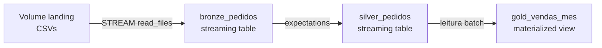

# Lab 4: Pipeline declarativo (Lakeflow Spark Declarative Pipelines)

**Situação:** não iniciado. Último na ordem de prioridade.
**Seções do guia:** 3 (objetos gold, qualidade) e 4 (pipeline como tarefa de job).
**Caderno de Estudos:** A6.

## Objetivo

Refazer o medalhão do Lab 3 de forma declarativa: streaming table na bronze, expectations na silver, materialized view na gold.

## Diagrama



## Pré-requisitos

- Limite da Free Edition: 1 pipeline ativo por tipo. Se a conta for trial, confirmar.
- O arquivo-fonte do pipeline precisa da extensão `.sql` ou `.py`.
- Código de pipeline não roda no notebook (erro esperado: "The DLT module is not supported on this cluster").

## Partes planejadas

1. Criar o pipeline (Jobs & Pipelines, Create, ETL pipeline) com catálogo `lab_de` e schema padrão `silver`. Interface na criação, porque o caminho por script é o bundle do Lab 6.
2. Arquivo `pedidos_medalhao.sql` com as 3 tabelas (rascunho abaixo).
3. Executar, ler o event log e as métricas das expectations.
4. Jogar o arquivo 04 na landing e ver as políticas de violação funcionando.
5. Perguntas e fechamento.

## Rascunho do código (conferir ao executar)

Sintaxe conferida na skill `lakeflow-pipelines-bundles` (set/2026). Nomes de colunas serão os mesmos da parte 1 do Lab 3.

```sql
-- Bronze: streaming table que lê só os arquivos novos do volume (Auto Loader por baixo)
CREATE OR REFRESH STREAMING TABLE bronze_pedidos
-- STREAM é obrigatório: sem ele a leitura é batch e a streaming table não é criada
AS SELECT * FROM STREAM read_files('/Volumes/lab_de/bronze/landing/', format => 'csv', header => true);

-- Silver: streaming table com regras de qualidade declaradas
CREATE OR REFRESH STREAMING TABLE silver_pedidos (
  -- Só conta a violação e mantém a linha
  CONSTRAINT tem_canal EXPECT (canal_venda IS NOT NULL),
  -- Descarta a linha sem chave
  CONSTRAINT tem_pedido EXPECT (pedido_id IS NOT NULL) ON VIOLATION DROP ROW,
  -- Falha a atualização se a quantidade for negativa
  CONSTRAINT quantidade_valida EXPECT (quantidade >= 0) ON VIOLATION FAIL UPDATE
)
-- Lê a bronze em modo streaming
AS SELECT * FROM STREAM(bronze_pedidos);

-- Gold: materialized view com agregação (leitura batch da silver)
CREATE OR REFRESH MATERIALIZED VIEW gold_vendas_mes
-- Agrupa por mês e soma o valor
AS SELECT date_trunc('MONTH', data_pedido) AS mes, SUM(quantidade * valor_unitario) AS total
-- Origem: a silver do mesmo pipeline
FROM silver_pedidos
-- Uma linha por mês
GROUP BY date_trunc('MONTH', data_pedido);
```

## Fatos que caem na prova

- Streaming table usa `CREATE OR REFRESH`. `CREATE OR REPLACE STREAMING TABLE` não existe.
- Expectations: `EXPECT` mantém e conta; `ON VIOLATION DROP ROW` descarta; `ON VIOLATION FAIL UPDATE` falha a atualização.
- Agregação sobre fonte streaming vai em materialized view com leitura batch.
- Materialized view com expectations perde o refresh incremental.
- Full refresh limpa tabelas e checkpoints; pode perder dado se a fonte não guardar histórico.
- Nome novo: Lakeflow (Spark) Declarative Pipelines, antes Delta Live Tables. `import dlt` virou `from pyspark import pipelines as dp`.
- AUTO CDC substitui APPLY CHANGES com a mesma sintaxe; SCD tipo 2 cria `__START_AT` e `__END_AT`.
