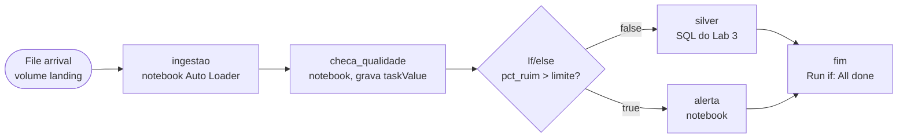

# Lab 5: Lakeflow Jobs

**Situação:** não iniciado. Segundo na ordem de prioridade.
**Seção do guia:** 4, Working with Lakeflow Jobs (16%).
**Caderno de Estudos:** A7.
**Questões do guia ligadas:** 9 (threshold de duração) e 10 (file arrival trigger).

## Objetivo

Montar um job com várias tarefas em DAG, controle de fluxo e trigger por chegada de arquivo, e ver na prática a diferença entre Warning e Timeout.

## Diagrama



## Partes planejadas

1. Notebooks das tarefas: reaproveitar o Auto Loader do Lab 2 e a limpeza do Lab 3. Cada notebook é uma tarefa própria (juntar tudo num notebook vira uma tarefa só).
2. Criar o job com as tarefas em DAG e o If/else lendo `{{tasks.checa_qualidade.values.pct_ruim}}`.
3. Configurar retries e ver as duas camadas do serverless.
4. Configurar **Metric thresholds**: Warning e Timeout de `Run duration`.
5. Ligar o **File arrival trigger** no volume `landing`, copiar um arquivo novo e ver o run com `Launched: By file arrival`. Pausar o trigger depois.
6. For each com uma lista de meses (opcional).
7. Perguntas e fechamento.

## Rascunho do notebook `checa_qualidade` (conferir ao executar)

```python
# Conta as linhas da bronze que têm valor resgatado (dado fora do contrato)
ruins = spark.table("lab_de.bronze.pedidos_auto").where("_rescued_data IS NOT NULL").count()
# Conta o total de linhas da bronze
total = spark.table("lab_de.bronze.pedidos_auto").count()
# Percentual de linhas ruins; evita divisão por zero se a tabela estiver vazia
pct = (ruins / total * 100) if total else 0.0
# Publica o valor para as próximas tarefas do job lerem como taskValue
dbutils.jobs.taskValues.set(key="pct_ruim", value=pct)
```

Na tarefa seguinte, fora do job (rodando à mão), o `get` precisa de `debugValue`:

```python
# Lê o valor publicado pela tarefa checa_qualidade
pct = dbutils.jobs.taskValues.get(
    # Chave da tarefa que publicou o valor
    taskKey="checa_qualidade",
    # Nome do valor
    key="pct_ruim",
    # Usado dentro do job quando a tarefa não publicou a chave
    default=0.0,
    # Usado fora do job; sem ele dá TypeError
    debugValue=99.9)
```

## Fatos que caem na prova

- Triggers: Scheduled, Table update, File arrival, Continuous, Manual (e Model update em Beta).
- File arrival: monitora volume ou external location; sobrescrever arquivo existente não dispara; path sem wildcard.
- Run if: All succeeded (padrão), At least one succeeded, None failed, All done, At least one failed, All failed.
- `Excluded` é o ramo não escolhido do If/else e não é falha; `Skipped` é dependência que falhou.
- Metric thresholds: **Warning** notifica e o run continua; **Timeout** cancela e deixa `Timed Out`; o timeout vale por tentativa.
- Retries no serverless: a auto-otimização pode fazer até 3 retries mesmo com "No retries"; desligá-la desliga também os seus retries.
- For each: concorrência padrão 1; não aninha; retries vão na tarefa aninhada.
- Histórico de runs: 60 dias.
- Tipos de tarefa citados no guia: notebook, SQL query, dashboard e pipeline.
- Free Edition: no máximo 5 tarefas concorrentes.
