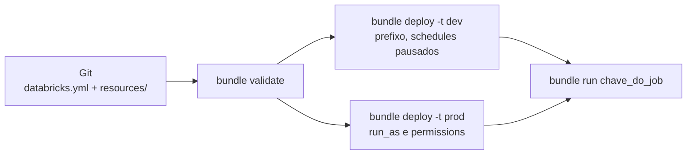

# Lab 6: Declarative Automation Bundles e CLI

**Situação:** não iniciado. Quarto na ordem de prioridade.
**Seção do guia:** 5, Implementing CI/CD (10%).
**Caderno de Estudos:** A8.
**Questões do guia ligadas:** 5 (bundles em Git com CI/CD) e 6 (`BUNDLE_VAR_`).

## Objetivo

Versionar o job do Lab 5 como código, com dois targets (dev e prod) no mesmo workspace, e usar variáveis para trocar catálogo e segredo sem mexer no YAML.

## Diagrama



## Pré-requisitos (no Windows, pelo Windows Terminal)

```powershell
# Instala a CLI nova (a antiga pelo pip não entende "bundle")
winget install Databricks.DatabricksCLI
# Confere a versão (mínimo 0.218.0 para bundles; 1.3.0+ usa o direct engine)
databricks version
# Login OAuth no workspace; sempre com --host para não abrir o seletor interativo
databricks auth login --host https://dbc-c699beda-0bbc.cloud.databricks.com --profile DEFAULT
```

Se `databricks bundle` não for reconhecido, rodar `pip uninstall databricks-cli`.

## Partes planejadas

1. `databricks bundle init default-minimal` numa pasta nova.
2. `databricks.yml` com `variables` (catálogo) e targets `dev` e `prod`; recursos em `resources/*.yml`.
3. `validate`, `deploy -t dev`, `run`, conferir o prefixo `[dev <usuario>]` e o schedule pausado.
4. Trocar a variável por `--var` e por `BUNDLE_VAR_catalogo`, e ver qual vence.
5. `deploy -t prod` com `run_as` e `permissions`; `destroy` no fim.
6. Git folder com GitHub (teste de 5 min; não confirmado na Free Edition).
7. Perguntas e fechamento.

## Rascunho do `databricks.yml` (conferir ao executar)

```yaml
# Identidade do bundle (único mapeamento obrigatório além de targets)
bundle:
  # Nome do bundle; aparece no caminho de deploy
  name: lab6_pedidos
# Puxa cada recurso do seu próprio arquivo
include:
  # Um arquivo por job ou pipeline
  - resources/*.yml
# Variáveis resolvidas no deploy
variables:
  # Catálogo de destino; pode vir de --var ou BUNDLE_VAR_catalogo
  catalogo:
    # Texto de ajuda da variável
    description: Catalogo de destino
    # Valor usado se ninguém informar outro
    default: lab_de
# Ambientes de deploy
targets:
  # Ambiente de desenvolvimento
  dev:
    # Target usado quando -t não é informado
    default: true
    # Prefixa nomes, pausa schedules, libera runs concorrentes
    mode: development
  # Ambiente de produção no mesmo workspace (Free Edition tem 1 workspace)
  prod:
    # Valida run_as, permissions e caminhos
    mode: production
    # Pasta compartilhada (o CLI avisa que é gravável por todos)
    workspace:
      # Caminho que não aponta para um usuário
      root_path: /Workspace/Shared/.bundle/${bundle.name}/${bundle.target}
    # Identidade que executa os recursos em prod
    run_as:
      # Seu usuário, porque não há service principal na Free Edition
      user_name: <seu-email>
```

## Fatos que caem na prova

- Nome novo: Declarative Automation Bundles (16/mar/2026). O comando continua `databricks bundle`.
- Prioridade das variáveis: `--var`, `BUNDLE_VAR_<nome>`, `variable-overrides.json`, `variables` do target, default.
- Variáveis são resolvidas no deploy; valor por execução usa parâmetros do job.
- `mode: development`: prefixa, pausa schedules e triggers, libera concorrência, tira o lock.
- `mode: production`: valida `run_as`, `permissions` e caminhos; bloqueia `--compute-id`.
- `bundle run` recebe a chave do recurso, não o nome final.
- Em CI, o target vem de `DATABRICKS_BUNDLE_TARGET` (`DATABRICKS_BUNDLE_ENV` está deprecada).
- Recomendação oficial: service principal para deploy de produção; OIDC (workload identity federation) é o caminho mais seguro no GitHub Actions.
- Nome novo: Git folders, antes Repos.
