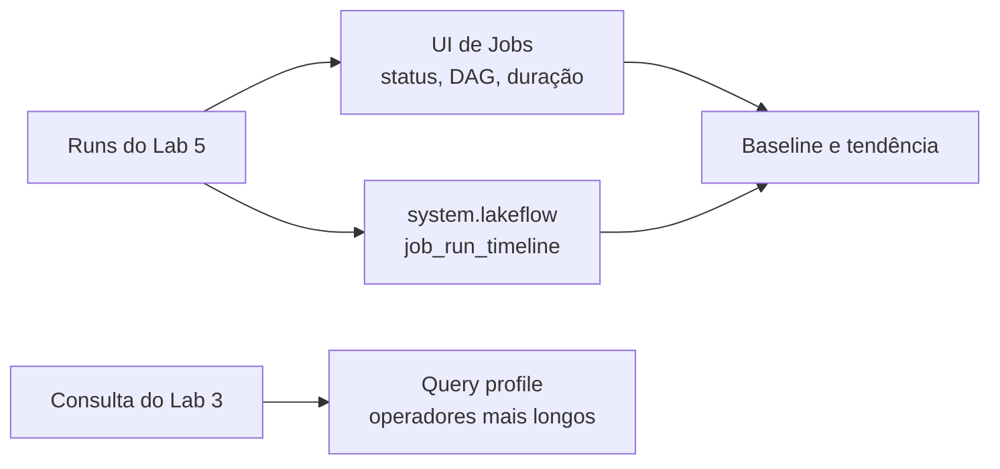

# Lab 7: Monitoramento e otimização

**Situação:** não iniciado. Quinto na ordem de prioridade.
**Seção do guia:** 6, Troubleshooting, Monitoring & Optimization (10%).
**Caderno de Estudos:** A9.
**Questão do guia ligada:** 1 (skew com AQE: salting).

## Objetivo

Ler a saúde dos jobs pela UI e pelas system tables, comparar duração com uma linha de base e diagnosticar uma consulta pelo query profile.

## Diagrama



## Partes planejadas

1. UI: Jobs & Pipelines, aba Runs; ler status, DAG, duração e os "Top 5 error types".
2. System tables: conferir se há acesso a `system.lakeflow` (exige `USE` e `SELECT` nos system schemas).
3. Duração por run do job do Lab 5 contra a média (baseline).
4. Query profile de uma consulta com join do Lab 3: operadores mais longos, % em Photon.
5. Liquid clustering e predictive optimization: `DESCRIBE DETAIL`, `SHOW TBLPROPERTIES` e `system.storage.predictive_optimization_operations_history`.
6. Spark UI, skew, shuffle e spill: só teoria, porque o serverless não tem Spark UI.
7. Perguntas e fechamento.

## Rascunho da consulta (conferir ao executar)

Padrão de join publicado na referência das system tables de jobs (learn.microsoft.com/azure/databricks/admin/system-tables/jobs, conferida em 19/11/2026).

```sql
-- CTE com a versão mais recente de cada job (a tabela jobs é SCD2)
WITH jobs AS (
  -- Numera as versões de cada job da mais nova para a mais velha
  SELECT *, ROW_NUMBER() OVER (PARTITION BY workspace_id, job_id ORDER BY change_time DESC) AS rn
  -- Tabela de jobs do schema lakeflow
  FROM system.lakeflow.jobs
  -- Fica só com a versão mais recente
  QUALIFY rn = 1
)
-- Cada run com o nome do job ao lado
SELECT job_run_timeline.*, jobs.name
-- Linha do tempo dos runs
FROM system.lakeflow.job_run_timeline
-- Junta pelo par workspace e job
LEFT JOIN jobs USING (workspace_id, job_id);
```

As colunas de duração (`run_duration_seconds`, `execution_duration_seconds` e outras) foram adicionadas em dez/2025 e não existem em linhas anteriores. Conferir com `DESCRIBE TABLE system.lakeflow.job_run_timeline` antes de calcular a baseline.

## Fatos que caem na prova

- `system.lakeflow` tem `jobs`, `job_tasks`, `job_run_timeline`, `job_task_run_timeline`, `pipelines` e `pipeline_update_timeline`. O schema antes se chamava `workflow`.
- Registros chegam em geral dentro de 1 hora.
- Skew: Max duration mais de 50% acima do percentil 75. O AQE trata skew join sozinho; se não resolver, salting ou pré-agregação.
- Spill: faltou memória de execução e o Spark foi para disco.
- Serverless não tem Spark UI; use o query profile.
- Photon não acelera UDF, RDD, streaming stateful nem consultas abaixo de 2 segundos.
- Liquid clustering substitui partitioning e ZORDER; `CLUSTER BY AUTO` exige predictive optimization.
- Evite `cache()`: no serverless ele lança exceção.
