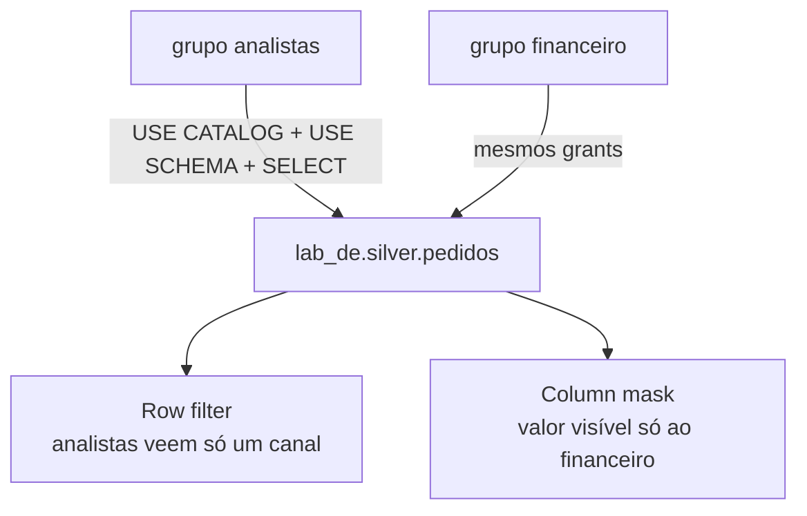

# Lab 8: Governança e segurança

**Situação:** não iniciado. Terceiro na ordem de prioridade.
**Seção do guia:** 7, Governance & Security (15%).
**Caderno de Estudos:** A2 e A10.
**Questões do guia ligadas:** 7 (column mask por grupo) e 8 (`UNSET MANAGED`).

## Objetivo

Controlar quem vê o quê na silver do Lab 3: privilégios nos 3 níveis, row filter e column mask por grupo, e entender managed x external e ABAC.

## Diagrama



## Pré-requisitos

- Criar 2 grupos em Settings, Identity and access (ex.: `analistas` e `financeiro`) e colocar seu usuário em um deles.
- Ter a silver do Lab 3 pronta.

## Partes planejadas

1. `GRANT` nos 3 níveis, `SHOW GRANTS`, `REVOKE` e `DESCRIBE CATALOG EXTENDED` para ver o dono.
2. Row filter com `is_account_group_member`.
3. Column mask no valor.
4. Testar trocando seu usuário de grupo.
5. Managed x external: `DESCRIBE TABLE EXTENDED` (linha Type); conversão `SET MANAGED` e `UNSET MANAGED` só se houver external location (não confirmado na Free Edition).
6. ABAC: governed tags e políticas, conferindo disponibilidade no workspace.
7. Perguntas e fechamento.

## Rascunho do código (conferir ao executar)

Sintaxe conferida na skill `databricks-eng-dados` (fonte: learn.microsoft.com/azure/databricks/data-governance/unity-catalog/filters-and-masks/manually-apply).

```sql
-- Permite ao grupo entrar no catálogo
GRANT USE CATALOG ON CATALOG lab_de TO `analistas`;
-- Permite ao grupo entrar no schema silver
GRANT USE SCHEMA ON SCHEMA lab_de.silver TO `analistas`;
-- Permite ler as tabelas do schema (vale para as atuais e as futuras)
GRANT SELECT ON SCHEMA lab_de.silver TO `analistas`;
-- Mostra os privilégios concedidos (o dono não aparece aqui)
SHOW GRANTS ON SCHEMA lab_de.silver;
```

```sql
-- Função de filtro: o financeiro vê tudo; os demais só o canal 'site'
CREATE OR REPLACE FUNCTION lab_de.silver.filtro_canal(canal STRING)
-- Retorna true para as linhas que o usuário pode ver
RETURN IF(is_account_group_member('financeiro'), true, canal = 'site');
-- Liga o filtro na tabela, passando a coluna canal_venda (no máximo 1 row filter por tabela)
ALTER TABLE lab_de.silver.pedidos SET ROW FILTER lab_de.silver.filtro_canal ON (canal_venda);
```

```sql
-- Função de máscara: só o financeiro vê o valor real
CREATE OR REPLACE FUNCTION lab_de.silver.mascara_valor(valor DOUBLE)
-- Os demais recebem nulo
RETURN CASE WHEN is_account_group_member('financeiro') THEN valor ELSE NULL END;
-- Liga a máscara na coluna valor_unitario
ALTER TABLE lab_de.silver.pedidos ALTER COLUMN valor_unitario SET MASK lab_de.silver.mascara_valor;
```

O valor `'site'` é exemplo. Trocar por um canal real visto na parte 1 do Lab 3. Antes de apagar uma função, tirar o filtro ou a máscara (`DROP ROW FILTER`, `DROP MASK`), senão a tabela fica inacessível.

## Fatos que caem na prova

- Ler tabela exige `USE CATALOG` + `USE SCHEMA` + `SELECT`.
- `ALL PRIVILEGES` não inclui `MANAGE`.
- Privilégios em catálogo ou schema valem para objetos atuais e futuros.
- Ownership não herda para baixo.
- Uma tabela tem no máximo 1 row filter.
- O comando SQL `DENY` não é suportado no Unity Catalog (só `hive_metastore`). No UC existe a política ABAC DENY (Beta), que nega só `MANAGE ACCESS CONTROL`.
- ABAC: governed tags; políticas de row filter, column mask, GRANT e DENY; a política não concede acesso, o principal ainda precisa de `SELECT`.
- `ALTER TABLE ... SET MANAGED` converte external para managed; `UNSET MANAGED` desfaz em até 14 dias.
- Tabela managed é a recomendada; predictive optimization só atua em managed.
